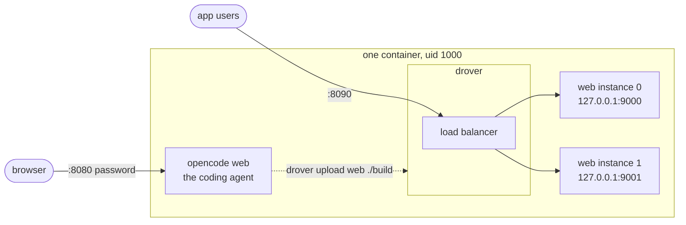

# drover in opencode-host

[opencode-host](https://github.com/mrofi/opencode-host) is a container image that runs
[opencode](https://opencode.ai) (`opencode web`) inside tmux behind a password, so you can use the coding
agent from any browser. It is a base image: you build your own image on top of it and add tools, config and
boot logic through its hook directories. It runs as the non-root `node` user (uid 1000).

This example adds drover to it, so the app you or the agent build inside the container is served properly:
supervised, load balanced, and replaceable without downtime.



opencode keeps port 8080. drover serves the app `web` on 8090 and does not touch opencode.

## What is in this folder

| File | What it does |
|---|---|
| `Dockerfile` | Starts from `ghcr.io/mrofi/opencode-host`, copies in the drover binary and the files below. |
| `drover.yaml` | One app, `web`: two instances on port 8090. No binary is in the image; drover starts empty. |
| `entrypoint.d/20-drover.sh` | opencode-host boot hook. Starts drover in the background before opencode starts. |
| `shutdown.d/20-drover.sh` | opencode-host shutdown hook. Stops drover (and the instances) before the final backup. |
| `AGENTS.d/20-drover.md` | Added to the instructions opencode reads, so the agent knows how to deploy and roll back. |

These are the four extension points opencode-host offers
([its guide](https://github.com/mrofi/opencode-host/blob/main/docs/extending.md)); no base script is edited.

## Build and run

From the repository root. The first line is only needed to try a local build of drover; without it the
published `ghcr.io/mrofi/drover:latest` is pulled:

```sh
docker build -t ghcr.io/mrofi/drover:latest .
docker build -t opencode-host-drover examples/opencode-host
docker run -d --name ocd -p 8080:8080 -p 8090:8090 \
  -e OPENCODE_SERVER_PASSWORD='choose-a-long-password' \
  opencode-host-drover
```

- `http://localhost:8080` is opencode (user `opencode`, your password).
- `http://localhost:8090` is the app. It answers `503 no healthy instance` until a first version is deployed.

## Deploy the app

The binary must serve HTTP on the port it gets as `--port <n>` (to use `$PORT` or other flags, change
`command` in `drover.yaml`; see the main README).

Ask the agent to build and deploy, or do it yourself in the container:

```sh
docker exec ocd drover upload web /home/node/work/myapp/bin/web --version v1
docker exec ocd drover status web
docker exec ocd drover upload web /home/node/work/myapp/bin/web --version v2   # rolling, no failed requests
docker exec ocd drover rollback web                                            # back to v1
```

`drover llms` inside the container prints the full reference.

## Things to know

- **The app port has no password.** opencode's password protects 8080 only. Publish 8090 only where the app
  may be reached, or put your own proxy with authentication in front of it.
- **Deployed versions are backed up with opencode's state.** The Dockerfile sets
  `BACKUP_EXTRA_DIRS="drover=/home/node/.local/share/drover"`, so when the S3 backup is on, drover's data
  directory goes to `extra/drover` in the bucket and comes back before drover starts. A recreated
  container serves the version it had. Without a bucket there is no backup, and the app is empty again
  until the next upload. This needs an opencode-host image with `BACKUP_EXTRA_DIRS`.
- **Every version is in the bucket.** Delete old ones with `drover rm web <version>` to keep it small.
- **A failing hook does not stop opencode.** opencode-host logs it and carries on. If the app port does not
  answer at all, look for `[entrypoint] hook 20-drover.sh` and drover's lines in `docker logs ocd`.
- **The agent can deploy.** With `AGENTS.d/20-drover.md` in place it can replace what port 8090 serves. That
  is the point of this example; leave the file out if you want to deploy by hand only.

## Tested

Built on the published `ghcr.io/mrofi/opencode-host:latest` with a locally built drover image, then run:
the boot hook started drover, opencode answered 401 without and 200 with the password, a first version was
uploaded, 300 requests during a rollout and a rollback all returned 200, a killed instance came back, and
the shutdown hook stopped drover on `docker stop`.

Backup of drover's data directory, built on local images of drover and of opencode-host with
`BACKUP_EXTRA_DIRS`, against a local directory as the backup target with encryption on: a binary version and
a folder version (with a symlink and a lock file) were uploaded, the container was stopped and deleted, and
a new one started from the backup served both, healthy, with the folder intact.

Not tested: a real S3 bucket, and a binary
that the agent itself built.
